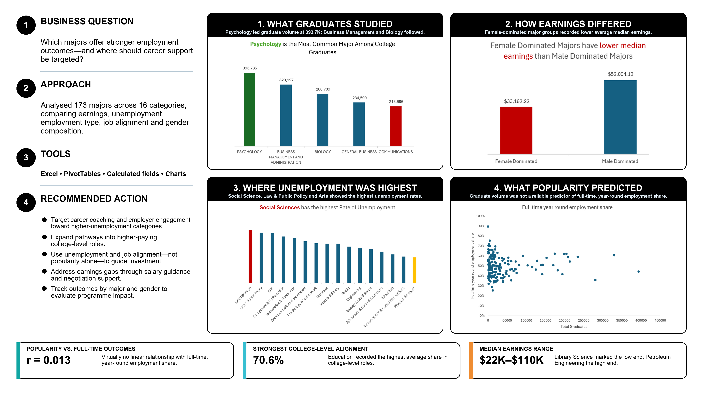

# Graduate Employment Outcomes Analysis

## Executive summary

This Excel portfolio project evaluates how graduate majors differ across employment, unemployment and earnings outcomes. The analysis was designed to help career-services and workforce-planning stakeholders determine where targeted support and stronger pathways into college-level roles may be most valuable.



## Business question

Which majors offer stronger employment outcomes, and where should career support and pathway development be targeted?

## Stakeholder requirements

- Compare graduate volume, earnings and unemployment across major categories.
- Identify categories with the greatest need for employment support.
- Examine whether popular majors consistently produce stronger full-time outcomes.
- Present recommendations in a format suitable for non-technical decision-makers.

## Dataset

- 173 majors
- 16 major categories
- Measures covering graduate volume, median earnings, unemployment, employment type, job alignment and gender composition

  ### Data source and attribution

- **Dataset:** [College Majors – Recent Graduates](https://github.com/fivethirtyeight/data/blob/master/college-majors/recent-grads.csv)
- **Publisher:** FiveThirtyEight
- **Underlying source:** American Community Survey, 2010–2012 Public Use Microdata Sample
- **Documentation:** [College Majors dataset documentation](https://github.com/fivethirtyeight/data/blob/master/college-majors/readme.md)
- **Date accessed:** October 10, 2026
- **Analysis file:** `analysis/graduate_outcomes_analysis.xlsx`
- **Modifications:** Reviewed the source fields and created PivotTables, calculated fields, charts and summarized major categories for portfolio analysis.
- **License:** FiveThirtyEight data repository, CC BY 4.0.

This project uses public portfolio data and does not contain confidential client or employer information.

## Tools used

- Microsoft Excel
- PivotTables
- Calculated fields
- Charts and data visualization

## Analytical approach

1. Reviewed and cleaned the underlying fields.
2. Grouped majors into broader categories.
3. Created PivotTables for graduate volume, earnings and unemployment.
4. Calculated full-time, year-round employment share and college-level job alignment.
5. Compared graduate popularity with employment outcomes.
6. Converted the findings into stakeholder-focused recommendations.

## Key insights

- Psychology recorded the largest graduate volume among the leading majors reviewed.
- Female-dominated major groups recorded lower average median earnings than male-dominated groups in this dataset.
- Social Sciences, Law & Public Policy and Arts showed comparatively high unemployment.
- Graduate volume had virtually no linear relationship with full-time, year-round employment share (`r = 0.013`).
- Education recorded the strongest average alignment with college-level roles at `70.6%`.
- Median earnings ranged from approximately `$22K` to `$110K` across majors.

## Recommendations

1. Target career support toward categories with comparatively high unemployment.
2. Expand pathways into higher-paying, college-level roles.
3. Use employment outcomes—not popularity alone—to guide investment.
4. Monitor earnings and job-alignment gaps across major groups.
5. Provide students with outcome-based career information earlier in their programs.

## Repository structure

```text
graduate-employment-outcomes/
├── analysis/
│   └── graduate_outcomes_analysis.xlsx
├── visuals/
│   └── graduate-employment-outcomes-poster.png
└── README.md
```

## Limitations

- This is an observational analysis and does not establish causation.
- Broad major categories can conceal variation among individual majors.
- Employment outcomes may also be influenced by location, experience, industry and economic conditions.

## Author

**Joy Ezike** — [Portfolio](https://joy-ezike.my.canva.site/) | [LinkedIn](https://www.linkedin.com/in/joy-ezike/)
